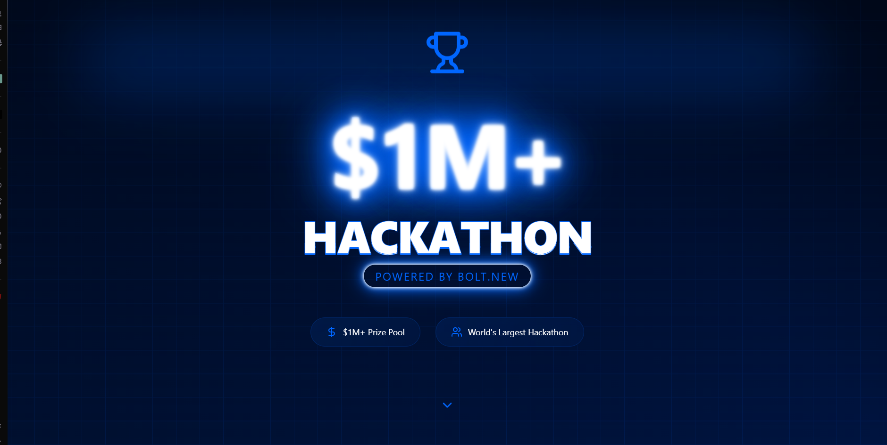

# BOLT.NEW $1M+ Hackathon



## About This Project

This is a modern, visually striking landing page for the world's largest hackathon with a $1M+ prize pool, powered by BOLT.NEW. The page features an immersive, animated design with multiple sections showcasing the hackathon's key features, judges, and registration functionality.

## Features

- Dynamic animated hero section with impressive visual effects
- Interactive scrolling experience with section transitions
- Features showcase highlighting key benefits
- Judges section featuring industry leaders
- User registration form with role selection (attendee/sponsor)
- Fully responsive design for all device sizes
- Modern glass-morphism UI elements with hover effects
- Dynamic animations and transitions

## Technology Stack

### Frontend Framework
- React 18 (with TypeScript)
- Vite for fast development and optimized builds

### Styling & UI
- Tailwind CSS for utility-first styling
- Custom CSS animations and effects
- Glass-morphism UI design
- Responsive layout design

### Icons & Visual Elements
- Lucide React icon library
- Custom animations (float, neon, glitch effects)
- Gradient backgrounds with animated transitions

### Development Tools
- TypeScript for type safety
- ESLint for code quality
- PostCSS for CSS processing
- Autoprefixer for browser compatibility

## Getting Started

1. Clone the repository
2. Install dependencies:
   ```bash
   npm install
   ```
3. Start the development server:
   ```bash
   npm run dev
   ```
4. Build for production:
   ```bash
   npm run build
   ```
5. Preview the production build:
   ```bash
   npm run preview
   ```

## Project Structure

- `src/App.tsx` - Main application component
- `src/index.css` - Global styles and animations
- `src/main.tsx` - Application entry point
- `public/` - Static assets
- `vite.config.ts` - Vite configuration

## Customization

The landing page can be easily customized by modifying:
- Color scheme in the CSS variables within `index.css`
- Content sections in `App.tsx`
- Animation parameters in `index.css`
- Tailwind configuration in `tailwind.config.js`

## License

This project is for demonstration purposes.